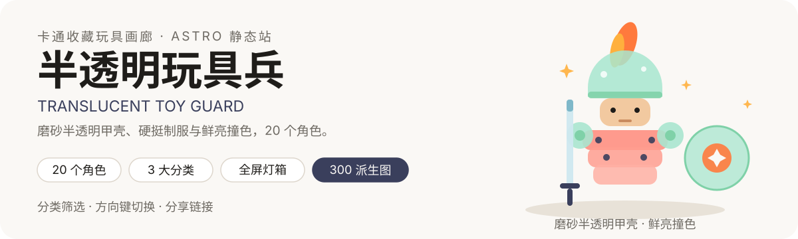
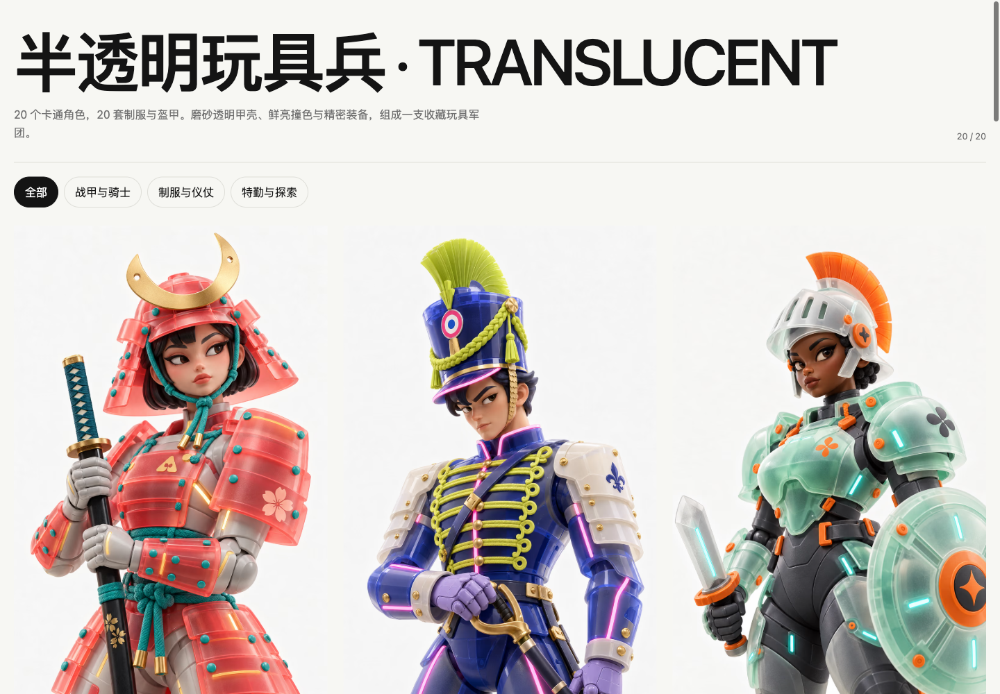

<p align="right"><a href="README.md">中文</a></p>

<p align="center">
  
</p>

<p align="center">
  <a href="https://translucent-toy-guard.xiaosang.cc/">▶ Visit the Gallery</a>
  ·
  <a href="https://github.com/holynova/translucent-toy-guard">GitHub Repository</a>
</p>

Translucent Toy Guard is a gallery of 20 cartoon collectible figures: 20 characters, 20 uniforms and armors — frosted translucent shells, rigid uniforms and vibrant clashing palettes, forming a collectible toy legion. White minimal grid, with category filters, a fullscreen lightbox, keyboard navigation and sharing. Source images and generation prompts are included.

## Screenshot

<p align="center">
  
</p>

## The Collection

20 figures (1024×1536) in 3 categories:

| Category | Count | Figures |
| :--- | :---: | :--- |
| 战甲与骑士 (Armor & Knights) | 9 | 珊瑚红武士 (Coral Samurai), 薄荷绿重装骑士 (Mint Heavy Knight), 紫罗兰罗马百夫长 (Violet Roman Centurion), 冰蓝极地巡逻员 (Ice-Blue Polar Patrol), 粉红装甲骑兵 (Pink Armored Cavalry), 银白古典重甲骑士 (Silver Classical Heavy Knight), 沙黄沙漠装甲侦察兵 (Sand Desert Armored Scout), 淡紫弓箭卫士 (Lavender Archer Guard), 翡翠装甲守卫 (Jade Armored Guard) |
| 制服与仪仗 (Uniforms & Ceremony) | 7 | 靛蓝骠骑兵 (Indigo Hussar), 钴蓝海军卫士 (Cobalt Navy Guard), 墨绿苏格兰仪仗兵 (Dark-Green Scottish Ceremonial Guard), 酒红宫廷火枪卫士 (Wine Court Musketeer), 翠绿近卫掷弹兵 (Emerald Grenadier Guard), 皇家蓝军乐鼓手 (Royal-Blue Band Drummer), 珍珠白仪仗统帅 (Pearl-White Ceremonial Commander) |
| 特勤与探索 (Specialists & Explorers) | 4 | 奶油黄飞行军官 (Cream Flight Officer), 白橙太空卫兵 (White-Orange Space Guard), 橙色消防装甲卫士 (Orange Firefighter Armored Guard), 青绿潜水卫兵 (Teal Diver Guard) |

## Experience

- **Category filters**: filter by the three categories; buttons show counts and a "showing X of Y" indicator (「已显示 X / 共 Y 张」).
- **Fullscreen lightbox**: open any figure for a full-size view, fitted to the viewport height; arrow keys move to the next or previous figure, Esc closes.
- **Sharing**: every image has a shareable link; share feedback distinguishes 「已分享」 (shared) / 「链接已复制」 (link copied) / 「无法分享」 (failed) — failures are never misreported as success.
- **Accessibility**: all 20 images have descriptive alt text.

## Run Locally

Node.js ≥ 22.12:

```bash
npm ci
cp .env.example .env
npm run ingest     # generates 300 derivatives (thumbnails / detail images, AVIF + WebP + JPEG)
npm run dev
```

```bash
npm run validate
npm run check      # astro check
npm test           # vitest, 7 tests
npm run build
```

## Tech

- An Astro 7 static site with a white minimal grid template; content is declared in YAML (`content/images.yml` figure metadata, `content/collections.yml` categories, `content/site.yml` site config).
- Image pipeline (`scripts/image-pipeline.ts` + `ingest.ts`): 20 source images at 1024×1536 generate 300 derivatives — thumbnails at 480/768, detail images at 960/1440/1920, in AVIF / WebP / JPEG; only `dist` is deployed, source images are not uploaded.
- Generation prompts are saved in `prompts.json`; source images live in `incoming/`.

```
src/pages/index.astro   Gallery homepage (filters / grid / lightbox)
src/components/         GalleryCard and other components
src/lib/                schema / paths / stats
scripts/                ingest / validate / image-pipeline / slug
content/                images.yml / collections.yml / site.yml
incoming/               20 source PNGs (1024×1536)
prompts.json            Full generation prompts
```

## License

MIT, see `LICENSE`.
