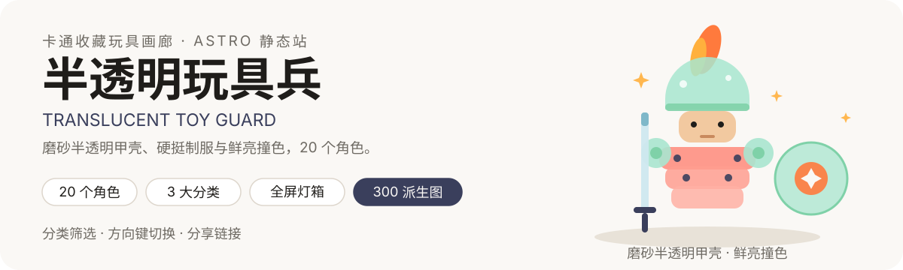
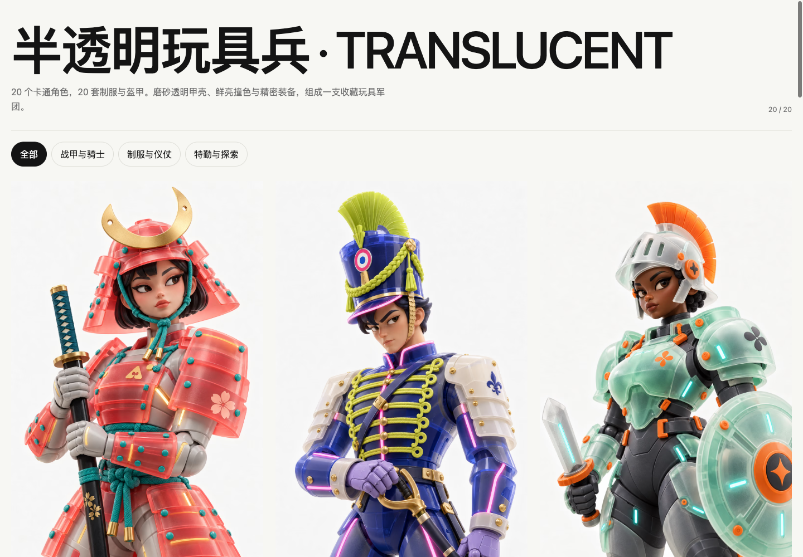

<p align="center">
  
</p>

<p align="center">
  <a href="https://translucent-toy-guard.xiaosang.cc/">▶ 在线观展 Visit the Gallery</a>
  ·
  <a href="https://github.com/holynova/translucent-toy-guard">GitHub 仓库</a>
</p>

半透明玩具兵是一座卡通收藏玩具画廊：20 个角色、20 套制服与盔甲，磨砂半透明甲壳、硬挺制服与鲜亮撞色，组成一支收藏玩具军团。白色极简网格布局，支持分类筛选、全屏灯箱、方向键切换与分享。原图与生成提示词随源码保存。

Translucent Toy Guard is a gallery of 20 cartoon collectible figures: 20 characters, 20 uniforms and armors — frosted translucent shells, rigid uniforms and vibrant clashing palettes, forming a collectible toy legion. White minimal grid, with category filters, a fullscreen lightbox, keyboard navigation and sharing. Source images and generation prompts are included.

## 截图 / Screenshots

<p align="center">
  
</p>

## 角色 / The Collection

20 个角色（1024×1536），3 大分类：

| 分类 | 数量 | 角色 |
| :--- | :---: | :--- |
| 战甲与骑士 | 9 | 珊瑚红武士、薄荷绿重装骑士、紫罗兰罗马百夫长、冰蓝极地巡逻员、粉红装甲骑兵、银白古典重甲骑士、沙黄沙漠装甲侦察兵、淡紫弓箭卫士、翡翠装甲守卫 |
| 制服与仪仗 | 7 | 靛蓝骠骑兵、钴蓝海军卫士、墨绿苏格兰仪仗兵、酒红宫廷火枪卫士、翠绿近卫掷弹兵、皇家蓝军乐鼓手、珍珠白仪仗统帅 |
| 特勤与探索 | 4 | 奶油黄飞行军官、白橙太空卫兵、橙色消防装甲卫士、青绿潜水卫兵 |

## 体验 / Experience

- **分类筛选**：按三大分类过滤，按钮带计数，显示「已显示 X / 共 Y 张」。
- **全屏灯箱**：点开任意角色看高清大图，图片按屏幕高度完整适配；方向键切换上下一张，Esc 关闭。
- **分享**：每张图都有可分享链接；分享反馈区分「已分享 / 链接已复制 / 无法分享」，失败不谎报。
- **无障碍**：20 张图均有描述性 alt 文本。

## 本地运行 / Run Locally

Node.js ≥ 22.12：

```bash
npm ci
cp .env.example .env
npm run ingest     # 生成 300 个派生文件（缩略图 / 详情图，AVIF + WebP + JPEG）
npm run dev
```

```bash
npm run validate
npm run check      # astro check
npm test           # vitest，7 个测试
npm run build
```

## 技术 / Tech

- Astro 7 静态站，白色极简网格模板；内容用 YAML 声明（`content/images.yml` 角色元数据、`content/collections.yml` 分类、`content/site.yml` 站点配置）。
- 图片管线（`scripts/image-pipeline.ts` + `ingest.ts`）：20 张 1024×1536 原图生成 300 个派生文件——缩略图 480/768、详情图 960/1440/1920，AVIF / WebP / JPEG 三格式；发布只部署 dist，原图不上传。
- 生成提示词保存在 `prompts.json`，原图在 `incoming/`。

```
src/pages/index.astro   画廊首页（筛选 / 网格 / 灯箱）
src/components/         GalleryCard 等组件
src/lib/                schema / 路径 / 统计
scripts/                ingest / validate / image-pipeline / slug
content/                images.yml / collections.yml / site.yml
incoming/               20 张原图 PNG（1024×1536）
prompts.json            完整生成提示词
```

## English

**Translucent Toy Guard** is a gallery of 20 cartoon collectible figures — frosted translucent armor, rigid uniforms and vibrant palettes. A white minimal grid with category filters, a fullscreen lightbox, keyboard navigation and shareable image links.

- **The collection**: 20 figures at 1024×1536 — Armor & Knights (9), Uniforms & Ceremony (7), Specialists & Explorers (4). Source images in `incoming/`, generation prompts in `prompts.json`.
- **Experience**: filters with counts ("showing X of Y"), a fullscreen lightbox that fits the image to the viewport height, arrow-key navigation, and honest share feedback (shared / link copied / failed).
- **Run it**: `npm ci && cp .env.example .env && npm run ingest && npm run dev`. Checks: `npm run validate`, `npm run check`, `npm test` (vitest, 7 tests).
- **Tech**: Astro 7 static site. The image pipeline generates 300 derivatives (thumbnails 480/768, detail 960/1440/1920, AVIF + WebP + JPEG); only `dist` is deployed.

## 许可 / License

MIT，见 `LICENSE`。
