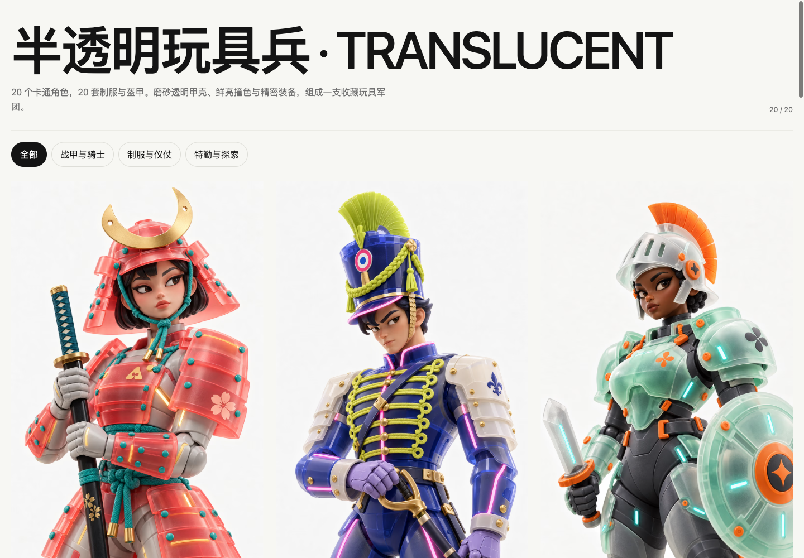

# 半透明玩具兵 · Translucent Toy Guard

20 个卡通收藏玩具角色：硬挺制服、磨砂半透明盔甲、鲜亮撞色与精密装备。支持分类筛选、全屏灯箱、方向键切换和分享。原图与生成提示词随源码保存。

A gallery of 20 cartoon collectible figures with rigid uniforms, frosted translucent armor and vibrant palettes. Includes category filters, a fullscreen lightbox, keyboard navigation and shareable image links. Source images and generation prompts are included.



## 在线体验 / Live Demo

- [Cloudflare Demo](https://translucent-toy-guard.xiaosang.cc/)
- [GitHub Repo](https://github.com/holynova/translucent-toy-guard)


## 本地运行 / Run locally

Node.js >=22.12.

```bash
npm ci
cp .env.example .env
npm run ingest
npm run dev
```

## 验证 / Validate

```bash
npm run validate
npm run check
npm test
npm run build
npm run deploy:check
```

## 发布 / Deploy

```bash
npm run deploy
```

Cloudflare Workers Static Assets · `translucent-toy-guard.xiaosang.cc`

从 main 同一提交在本地手动发布；不使用部署分支或自动发布 workflow。因 Custom Domain 配额已满，通过代理 DNS 与精确 Worker Route 保留正式子域名。

Publish manually from the same main commit. A proxied DNS record and an exact Worker Route serve the canonical domain. Production includes one unified Umami tracker.
